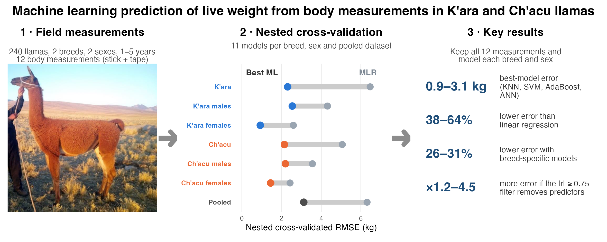
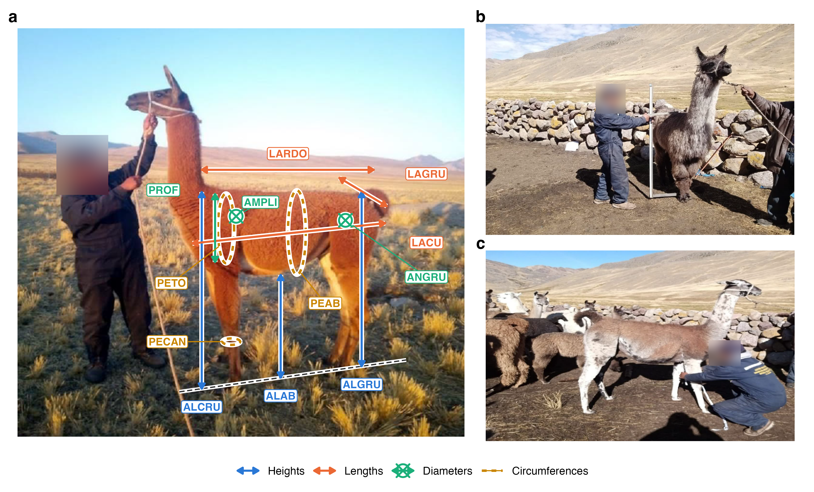
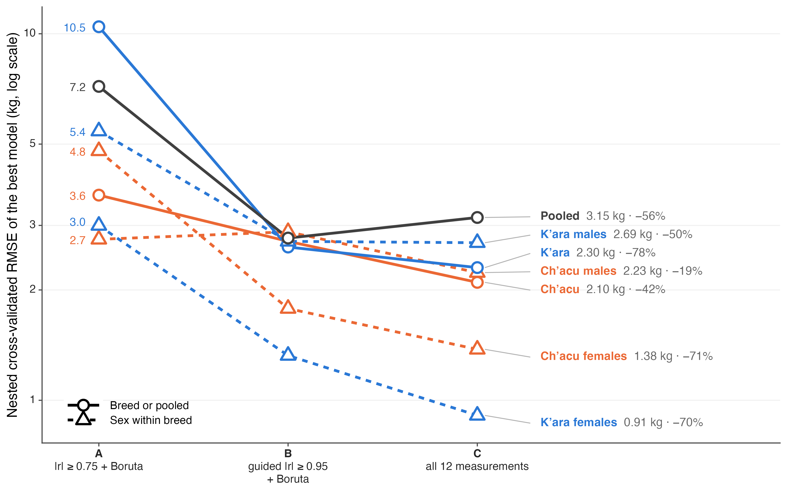
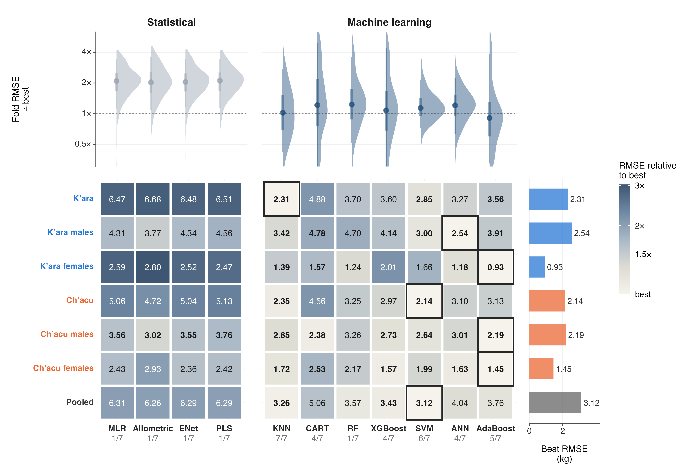

# Machine Learning Prediction of Live Weight from Zoometric Measurements in K'ara and Ch'acu Llamas

**Seven machine learning algorithms and four statistical models, nested cross-validation, and a critical look at the correlation filter used in earlier livestock studies — 240 llamas (*Lama glama*) from the Peruvian Altiplano.**

[](#citation)
[](LICENSE)
[](#data--code-availability)
[](https://www.r-project.org/)
[](https://www.python.org/)
[](#methods-in-brief)

<p align="center">
  
</p>

---

## Overview

Live weight guides feeding, health treatment and selection of llamas, but scales are rarely available in high-Andean herds. This repository contains the complete code of a study that predicts live weight from twelve body measurements taken with a zoometric stick and a measuring tape, in two breeds kept for different purposes: the meat-oriented **K'ara** and the fibre-oriented **Ch'acu**.

The study answers three questions:

1. **Which algorithm predicts live weight best**, analysing each breed and sex separately?
2. **Does the |r| ≥ 0.75 correlation filter** used in earlier sheep and alpaca studies help or hurt when animals of several ages are combined?
3. **Which measurements carry the most information** in each group?

<p align="center">
  
  <br><sub><b>Figure 2.</b> The twelve zoometric measurements on a llama of the study herd (a) and measurement in the field (b, c). Faces of the staff are blurred.</sub>
</p>

---

## Key results

**Nested cross-validated performance of the best model** (all twelve measurements; 10-fold outer CV repeated 10 times, inner 5-fold tuning)

| Dataset | Best model | RMSE (kg) | MAE (kg) | MAPE (%) | R² | MLR RMSE | vs MLR |
|---|---|:---:|:---:|:---:|:---:|:---:|:---:|
| K'ara | KNN | **2.31** | 1.37 | 1.67 | 0.991 | 6.47 | −64% |
| K'ara males | ANN | **2.54** | 2.06 | 2.45 | 0.993 | 4.31 | −41% |
| K'ara females | AdaBoost | **0.93** | 0.60 | 0.73 | 0.996 | 2.59 | −64% |
| Ch'acu | SVM | **2.14** | 1.81 | 2.46 | 0.991 | 5.06 | −58% |
| Ch'acu males | AdaBoost | **2.19** | 1.38 | 1.70 | 0.981 | 3.56 | −38% |
| Ch'acu females | AdaBoost | **1.45** | 1.14 | 1.40 | 0.991 | 2.43 | −40% |
| Pooled | SVM | **3.12** | 2.42 | 3.11 | 0.985 | 6.31 | −51% |

- **No single algorithm was best**: KNN, SVM, AdaBoost and a regularised neural network led different datasets; KNN was statistically equivalent to the best model in all seven (corrected resampled *t*-test).
- **The |r| ≥ 0.75 filter discarded the most informative measurements**: it kept only two or three predictors and raised the error 1.2 to 4.5 times compared with using all twelve.
- **Breed-specific models had 26–31% lower error** than the pooled model.
- Predictions were unbiased and well calibrated (Bland–Altman bias −0.25 to 0.11 kg; calibration slope 0.99–1.02), but **errors within an age class were larger** — the overall R² mainly reflects the 1–5-year age range.

<p align="center">
  
  <br><sub><b>Figure 5.</b> Error of the best model under the three predictor selection strategies: the correlation filter (A) raises the error in almost every dataset.</sub>
</p>

<p align="center">
  
  <br><sub><b>Figure 6.</b> Nested cross-validated RMSE of the eleven models. Statistical models cluster around twice the error of the best machine learning model.</sub>
</p>

### Field equations (heart girth only)

For producers with only a measuring tape — PEVI in kg, PETO (heart girth) in cm; cross-validated error:

| Group | Equation | RMSE (kg) | MAPE (%) |
|---|---|:---:|:---:|
| K'ara males | PEVI = 1.18 × 10⁻⁴ · PETO^2.858 | 7.57 | 6.7 |
| K'ara females | PEVI = 2.32 × 10⁻⁴ · PETO^2.720 | 7.55 | 8.3 |
| Ch'acu males | PEVI = 7.41 × 10⁻⁶ · PETO^3.432 | 6.94 | 7.0 |
| Ch'acu females | PEVI = 3.83 × 10⁻⁵ · PETO^3.113 | 6.03 | 6.9 |

---

## Methods in brief

| Step | Implementation |
|---|---|
| Data | 240 llamas of CIP La Raya (Universidad Nacional del Altiplano de Puno), 2 breeds × 2 sexes × 5 ages × 12 animals; single biometric survey (2015) |
| Datasets | K'ara, Ch'acu, each breed by sex, and pooled (7 datasets) |
| Quality control | Robust z-scores of breed × sex × age ANOVA residuals; re-fitted inside every training fold |
| Predictor selection | A: \|r\| ≥ 0.75 filter + Boruta · B: response-guided \|r\| ≥ 0.95 filter + Boruta · C: all 12 measurements — all fitted inside training folds |
| Models | MLR, allometric (log–log), elastic net, PLS, KNN, CART, random forest, XGBoost, SVM (RBF), ANN (one hidden layer, weight decay), AdaBoost |
| Validation | Nested CV: outer 10-fold × 10 repeats stratified by breed × sex × age; inner 5-fold hyperparameter tuning |
| Comparison | Friedman test; Nadeau–Bengio corrected resampled *t*-test against the best model |
| Agreement | Bland–Altman (bias, limits of agreement, proportional bias), calibration slope and intercept, within-age errors |
| Importance | Permutation importance in the outer test folds |

---

## Repository structure

```
ml-live-weight-zoometric-chacu-kara-llamas/
├── 01_DATA/
│   └── README.md                 # Data dictionary — the data themselves are NOT included
├── 02_CODE/
│   ├── R/                        # Modules: loading, quality control, ANOVA, models, figures, map
│   ├── analisis.R                # Descriptive statistics, ANOVA, slope-homogeneity tests
│   ├── ecuaciones_campo.R        # Field equations (heart girth) with 10×10 CV
│   ├── figuras_v3.R              # Manuscript figures 2–10
│   ├── figuras_articulo.R        # Figure 1 (study area) and Figure 4 (correlations)
│   ├── graphical_abstract.R      # Graphical abstract
│   └── python_nested/            # Nested cross-validation (scikit-learn, XGBoost)
│       ├── nested.py             # Outer/inner CV for strategies A, B and C
│       ├── summarize.py          # Equivalence tests, Bland–Altman, within-age errors
│       ├── importance.py         # Permutation importance
│       ├── export_csv.py         # Exports fold results for the R figures
│       └── fotos_campo.py        # Blurs staff faces in the field photographs
└── 03_RESULTS/
    ├── nested_2026-10-20/        # Aggregated metrics per dataset and model (no animal-level data)
    ├── ecuaciones_campo.csv      # Field equation coefficients and CV error
    └── figures/                  # Manuscript figures and graphical abstract
```

> **Note.** Only aggregated results are published. Files that contain animal-level values — the raw spreadsheet, out-of-fold predictions per animal, fold-level selections and the outlier log — are excluded because the data are private (see below).

---

## Reproducing the results

With access to the data file (see [Data & Code Availability](#data--code-availability)), place it in `01_DATA/` with its original name and run from the repository root:

```bash
# 1. Nested cross-validation (Python 3.13)
cd 02_CODE/python_nested
python -m venv venv && venv/bin/pip install -r requirements.txt
venv/bin/python nested.py C 10 MLR,Allometric,ENet,PLS,KNN,CART,RF,XGBoost,SVM,ANN,AdaBoost   # ~40 min, 6 cores
venv/bin/python nested.py A 3 MLR,Allometric,ENet,PLS,KNN,CART,RF,XGBoost,SVM,ANN,AdaBoost
venv/bin/python nested.py B 3 MLR,Allometric,ENet,PLS,KNN,CART,RF,XGBoost,SVM,ANN,AdaBoost
venv/bin/python summarize.py && venv/bin/python importance.py && venv/bin/python export_csv.py
cd ../..

# 2. Descriptive analysis, field equations and figures (R 4.6)
Rscript 02_CODE/analisis.R
Rscript 02_CODE/ecuaciones_campo.R
Rscript 02_CODE/figuras_v3.R
Rscript 02_CODE/graphical_abstract.R
```

The data path can also be set with the environment variable `LLAMAS_XLSX`. All random seeds are fixed (`2026`). R packages are installed automatically by `02_CODE/R/paquetes.R` (main: ggplot2, patchwork, ggdist, ggside, ggtext, ggridges, scico, caret, sf, terra).

---

## Data & Code Availability

- **Code**: all code is released here under the MIT License.
- **Data**: the biometric records belong to the La Raya Research and Production Centre (CIP La Raya) of the Universidad Nacional del Altiplano de Puno and are **not publicly available**. They can be requested from the corresponding author and are shared with the permission of CIP La Raya.
- The field photographs were taken by the authors; faces of the staff have been blurred.

---

## Authors

Universidad Nacional del Altiplano de Puno (UNA-Puno), Peru.

| Author | Contribution | ORCID |
|--------|--------------|-------|
| **Vladimiro Ibañez Quispe** \* | Conceptualization · investigation · methodology · funding acquisition · project administration · supervision | [0000-0002-0277-4945](https://orcid.org/0000-0002-0277-4945) |
| **Bernabé Canqui Flores** | Conceptualization · methodology · formal analysis · validation | [0000-0003-2204-0620](https://orcid.org/0000-0003-2204-0620) |
| **Charles Ignacio Mendoza Mollocondo** | Methodology · data curation · validation · visualization | [0000-0002-4766-2701](https://orcid.org/0000-0002-4766-2701) |
| **Roberto Elvis Roque Claros** | Investigation · resources · data curation · validation | [0000-0001-6674-4684](https://orcid.org/0000-0001-6674-4684) |
| **Teresa Paola Alvarez Rozas** | Investigation · data curation · formal analysis · validation | [0000-0002-3214-4506](https://orcid.org/0000-0002-3214-4506) |
| **Alfredo Tumi Figueroa** | Conceptualization · investigation · validation | [0000-0003-2970-061X](https://orcid.org/0000-0003-2970-061X) |
| **Richar Andre Vilca-Solorzano** | Data curation · formal analysis · software · visualization · writing – original draft | [0009-0003-2385-5263](https://orcid.org/0009-0003-2385-5263) |

<sub>\* Corresponding author — vibanez@unap.edu.pe. All authors contributed to writing – review & editing.</sub>

---

## Citation

The article is being submitted for publication. Until it is published, please cite this repository:

```bibtex
@software{IbanezQuispe2026LlamaWeight,
  author = {Iba{\~n}ez Quispe, Vladimiro and Canqui Flores, Bernab{\'e} and
            Mendoza Mollocondo, Charles Ignacio and Roque Claros, Roberto Elvis and
            Alvarez Rozas, Teresa Paola and Tumi Figueroa, Alfredo and
            Vilca-Solorzano, Richar Andre},
  title  = {Machine learning prediction of live weight from zoometric measurements
            in Ch'acu and K'ara llamas: code},
  year   = {2026},
  url    = {https://github.com/Andre031222/ml-live-weight-zoometric-chacu-kara-llamas}
}
```

---

## Acknowledgments

Funded by the Vicerrectorado de Investigación of the Universidad Nacional del Altiplano de Puno (grant 0106-2025-VRI-UNA-Puno). We thank the staff of CIP La Raya for their help in handling the animals and recording the measurements.

---

## License

Code released under the **MIT License** — see [LICENSE](LICENSE). The data are not covered by this license and are not included.
